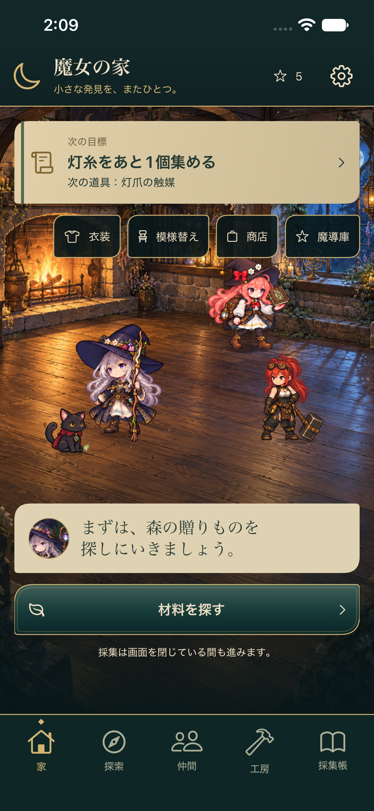
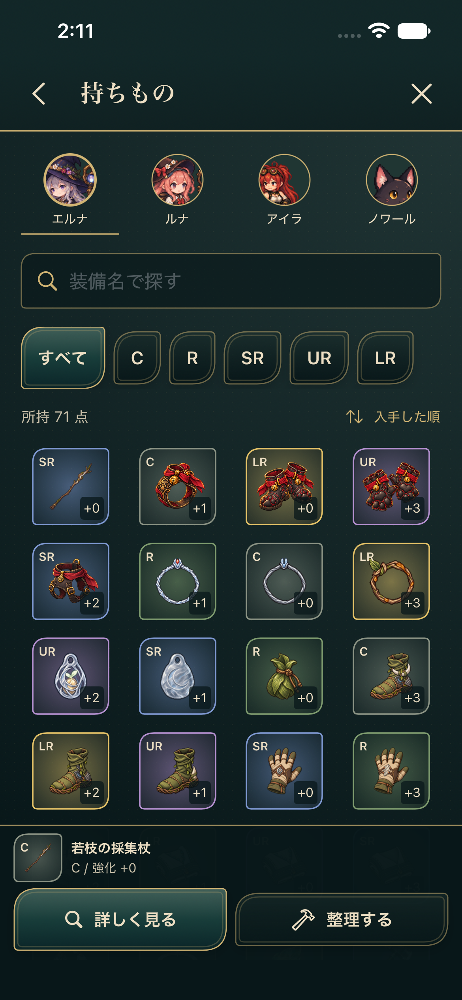

# 魔女の採集帳

**公開状態：2026年11月9日に既存のGitHubリポジトリをPublic化しました。R2では、所有者が無断利用の第三者画像・音楽素材はないことを確認しています。iOSアプリの一般配布・発売を意味するものではありません。**

森の家を拠点に、4人の仲間で採集・探索・自動戦闘を進め、集めた素材で装備を作り、研究と暮らしを育てるiPhone向けRPGです。

**2026-11-07整備版。** このrefには、UI48を統合したW008のゲームソース、Coreテスト、UIテスト、署名なしの再現用Xcodeプロジェクト、資材ハッシュ台帳が入っています。旧G1のブラウザ試作も履歴・資料として残しています。ゲーム全体の製品受入れは完了していません。

**アプリの再現には、所有者が保管するW008固定資材パックが別途必要です。Git取得だけではiOSアプリを再構築できません。** Coreの試験入力はこのrefで揃います。原画、実セーブ、署名設定、過去の巨大QA出力は今回追加していません。

## 現在地

|領域|状態|
|---|---|
|ゲームソース|W008作業入力261件を現物と照合。開発元checkpointは`d09b7f37`、アプリソース版は`26ab9d74`|
|UI48|S01〜S48の方向性は本人採用。実装と製品全体の完成判定は別|
|技術検証|今回の結果・失敗からの修正・skipを[検証記録](docs/project/VALIDATION.md)に分離|
|実機|前回監査に本人の起動・試遊報告あり。今回実機操作なし。対象ビルド・機種・OSとの独立照合は未完了|
|課金・発売|本番IAP・購入検証基盤・正式商品仕様は未完了。現在のApp Store公開・販売状態は未確認|
|開発判断|面白さ、目的・過程・達成感、バランス、継続性は本人判断が残る|

## 世界観と遊び方

候補実装には、魔女エルナ、見習いルナ、鍛冶を担うアイラ、使い魔ノワールが登場します。森の家から5地域へ出かけ、仲間と装備を選び、採集・探索の成果を工房や研究へつなぎます。詳細設定と正式採否は[企画正本](docs/design/DESIGN_BIBLE.md)と[設計索引](docs/design/shared/20261010_r1/CURRENT_DESIGN_INDEX.md)を参照してください。

- **採集と探索**：地域・目的地・担当を選び、経過した仕事の成果を受け取ります。次に必要な素材や目標を確認できます。
- **自動戦闘**：4人の編成と装備で戦闘へ進み、素材・装備・進行を獲得します。既存の枠組みは5地域・30戦・15課題です。
- **装備と工房**：所持品の比較、装備セット、保護・分解、制作、進化、強化、精錬、品質昇格を扱います。
- **研究と魔導庫**：研究、図鑑、課題、収集を進めます。提供割合や価格などの候補値を正式商品仕様として扱いません。
- **暮らし**：衣装・家具を試してから適用する導線があります。開発用候補・所有権・本番販売は別に扱います。

UI48はホーム、探索、装備、工房、図鑑・研究、暮らし、設定・復旧などの48画面です。下部の入口から移動し、詳細画面では「戻る」「閉じる」を使います。目標選択やプレビューだけでは消費・制作・購入は確定しません。実処理は確認画面の確定操作で行います。

## 画面

以下は今回の再現用ビルドから、新規専用Simulatorで取得した画面です。試験fixtureと製品版を[画面の出所](docs/project/SCREENSHOTS.md)で区別しています。





## 実装と残課題

探索、自動戦闘、採集、装備・制作・研究、ローカル保存・復旧、衣装・家具の確認導線はソースに実装されています。今回試した範囲は[検証記録](docs/project/VALIDATION.md)に限定されます。全48画面・全機能の受入れ、実機性能・長時間安定性、端末移行、本番課金、権利の最終確認、発売判断は残っています。[状態・既知の制約](docs/project/STATUS.md)を確認してください。

## Macで再開する

XcodeとCommand Line Tools、Python 3を使います。実測環境はXcode 27.2／Swift 6.4.2／iOS Simulator 27.2。CoreはSwift tools 6.0、macOS 14／iOS 17以上を宣言し、外部Swift package依存はありません。

```sh
git clone --branch codex/git-maintenance-20261107-r1 https://github.com/T-ishikawa00/witch-gathering-log.git
cd witch-gathering-log
python3 tools/repository/core_tests.py --output "$HOME/witch-validation/core-001"
```

iOSアプリは所有者の固定資材パックを用意してからビルドします。`--output`には存在しない、checkout外の専用ディレクトリを指定します。

```sh
python3 tools/repository/reproduce.py   --resources "$WITCH_RESOURCE_ROOT"   --output "$HOME/witch-validation/simulator-001"
```

`WITCH_RESOURCE_ROOT`はハッシュ一致する`PreparedResources`の絶対パスです。素材を無断でダウンロードする処理はありません。[再現手順](docs/project/REPRODUCTION.md)に資材の取得条件、Xcodeでの開き方、Simulator試験、実機引継ぎを記載しています。所有者のTeam・署名を含む元projectへこの設定を上書きしないでください。

## 構成

|パス|役割|
|---|---|
|[native/WitchApp](native/WitchApp)|SwiftUI・SpriteKit・StoreKit接続点とUI48|
|[native/WitchGameCore](native/WitchGameCore)|ゲーム計算、保存、復旧、Coreテスト|
|[native/WitchUITests](native/WitchUITests)|独立したQAセーブを使う既存UI試験|
|[native/WitchReproduction.xcodeproj](native/WitchReproduction.xcodeproj)|今回追加した、元projectと分離した署名なし再現設定|
|[native/ResourceManifests](native/ResourceManifests)|W008のソース・必須資材ハッシュ|
|[tools/repository](tools/repository)|再現・検証・Git保存範囲の確認|
|[docs/project](docs/project)|現在の入口・状態・履歴・資材・検証・運用|
|[docs/design](docs/design)|既存の企画正本と歴史資料|
|[src](src)、[reports](reports)|旧G1ブラウザ試作と当時の試験資料|

## 履歴と制作体制

G1は一人編成のブラウザ技術試作、R046/R088は選別した監査スナップショット、UI48 R020は画面統合、W008はその後の製品候補です。W009は署名なしiPhoneOSビルド識別で、別ゲームではありません。[開発履歴・ref対応](docs/project/HISTORY.md)で分離しています。

本人が企画方針、採否、優先順位、試遊、実機操作、製品・発売判断を担当し、ChatGPT・Codexが設計支援、実装、統合、技術検証、資料整備を支援しました。AIの試験成功を本人の採用・面白さ・権利・発売の承認へ読み替えません。

## 素材・権利・運用

[素材台帳](docs/project/ASSET_REGISTER.csv)は、存在、実装、本人採用、出所、権利、保存先を別々に記録します。R2では所有者が掲載対象の画像・音楽に無断利用の第三者素材がないことを確認しました。この所有者表明を根拠に画像ファイルの権利確認保留を解除し、AI_GENERATED／UNKNOWNの出自分類は変更していません。適用範囲と残る再現条件は[R2補足](docs/project/PUBLICATION_PREPARATION_R2.md)を参照してください。包括的なライセンスは付与していません。アプリ同梱フォントは今回検出しておらず、プラットフォームのフォント・SF Symbolsの条件は別途確認が必要です。

再開時は[Git運用](docs/project/GIT_WORKFLOW.md)に従い、新しいブランチ、限定したstage、秘密情報・権利・資材ハッシュの確認を行ってください。[セキュリティ検査](docs/project/SECURITY.md)と[ローカル・GitHubの対応](docs/project/REPOSITORY_MAP.md)には検査範囲と未保存データを記載しています。

R1の検査範囲は[公開準備候補R1の範囲](docs/PUBLICATION_PREPARATION_R1.md)、所有者確認を反映した素材の判定は[R2補足](docs/project/PUBLICATION_PREPARATION_R2.md)を参照してください。

## 公開準備 R2

作者・committerメールの公開承認と履歴整理の経緯は[公開準備R2](docs/PUBLICATION_PREPARATION_R2.md)に記録しています。R1の本人確認待ちは解消済みです。Privateでの移行検証を経て、2026年11月9日に既存のGitHubリポジトリをPublic化しました。
