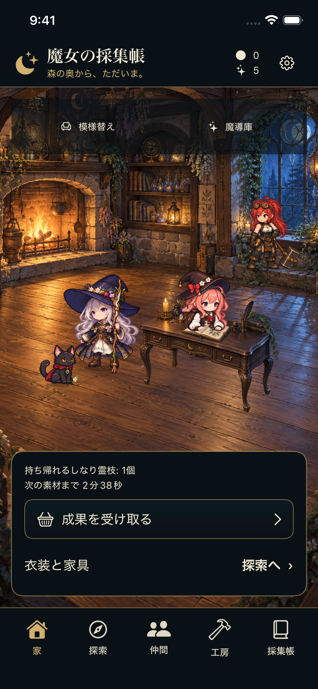
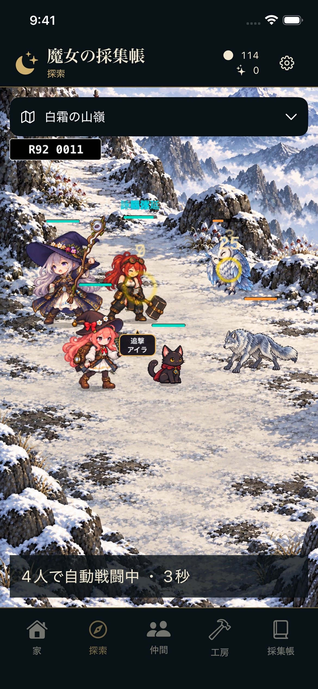
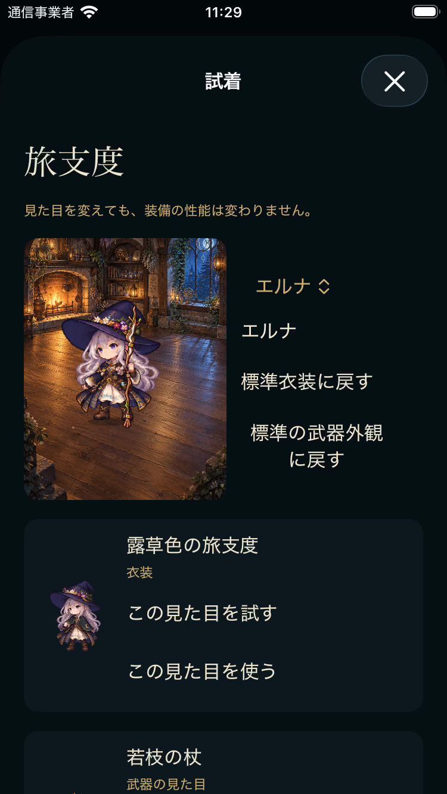

# 魔女の採集帳 — ③〜⑤ 独立監査用チェックポイント R046

このブランチは既存Privateリポジトリのmainを親にした、監査用の選別スナップショットです。実装の参照対象はSwiftUI/SpriteKitのiPhone版R093です。既存main由来の `src/`、`index.html` などは旧G1ブラウザ試作であり、正式な4人制ゲーム実装と混同しないでください。

開発は継続中です。新規美術・バランス・商品設定は未承認候補を含みます。自動テストの成功は、Humanの美術採用、楽しさ評価、実機確認、課金完成、公開承認を意味しません。

## 読む順序

1. [全体進捗と残作業](docs/production/current/qa_drafts/progress_checkpoint_r046/PROGRESS_REPORT_R046.md)
2. [正式委任と禁止事項](docs/production/mission_20261010_r1/Witch_Codex_Autonomous_03to05_20261010/01_CODEX_MASTER_MISSION.md)、[受入条件](docs/production/mission_20261010_r1/Witch_Codex_Autonomous_03to05_20261010/03_ACCEPTANCE_AND_BLOCKERS.md)
3. [設計正本の目次](docs/design/CURRENT_DESIGN_INDEX.md)、[設計本文](docs/design/DESIGN_BIBLE.md)、[未解決の競合](docs/design/DESIGN_CONFLICTS.md)、[決定状態](docs/design/DECISION_STATUS.md)
4. [現在の進捗](docs/production/current/CURRENT_STATUS.md)、[次の作業](docs/production/current/NEXT_ACTIONS.md)、[159制作単位の現物照合](docs/production/current/qa_drafts/progress_checkpoint_r046/ALL159_CURRENT_MAPPING_R001.json)、[個別コンテンツ台帳](docs/production/current/CONTENT_MATRIX_R059_APP020805.json)、[後発の個別検証](docs/production/current/CONTENT_PROGRESS_SUPPLEMENT_R071.json)
5. [ゲームコア](native/WitchGameCore/Sources/WitchGameCore)、[SwiftUI/SpriteKit実装](native/WitchApp)、[コア回帰テスト](native/WitchGameCore/Tests/WitchGameCoreTests)、[ネイティブUI検証コード](native/WitchUITests)
6. [R093ビルド証跡](docs/production/current/recovery_r022/integration_r093_notice_luna_grounding_r001/BUILD_RECEIPT_R002.json)、[コア212件の結果](docs/production/current/recovery_r022/integration_r093_notice_luna_grounding_r001/CORE_FULL_R006.json)、[iPhone向けコンパイル検証](docs/production/current/recovery_r022/integration_r093_notice_luna_grounding_r001/UNSIGNED_FINAL_VERIFICATION_R004.json)
7. [90日・複数ビルド比較](docs/production/current/independent_review/earned_build_comparison_r025/R025_REPORT_CURRENT.md)、[課金・クラッシュ・権限エラーの切り分け](docs/production/current/purchases/STOREKIT_INCIDENT_CURRENT.md)
8. [53装備利用箇所の監査](docs/production/current/independent_review/equipment_r093_native_r001/REVIEW_R001.md)、[追撃表示監査](docs/production/current/independent_review/notice_r092_native_r001/REVIEW.md)、[LUNA動作監査](docs/production/current/independent_review/luna_r093_r088_native_r001/REVIEW_R001.md)
9. [共有ファイルとハッシュ](docs/production/current/sharing_r046/SHARED_PAYLOAD_MANIFEST_R002.json)、[画面の出典とハッシュ](docs/production/current/sharing_r046/gallery/GALLERY_MANIFEST_R001.json)

## 実際のiOS Simulator画面

| 家（R052時点） | 探索・R04戦闘（R093） | 試着（R093） |
|---|---|---|
|  |  |  |

上記は実アプリの画面です。家は先行QA、探索は追撃表示の配置問題を含む検証中画面、試着はテストの選択子不一致を調査した時点です。正式な完成画面という扱いではありません。

## 共有範囲と再現限界

共有するのは、現在の実装ソース、コア用データとテスト、検証・制作コード、主要な結果、品質台帳、設計正本、少数の画面です。大容量の原画・生成フレーム・音源・録画・xcresult・ビルド・キャッシュ・過去の重複中間出力はローカルに保持し、この追加スナップショットでは送信しません。署名秘密鍵、認証情報、実取引の生ログも共有対象外です。

このため、この監査ブランチだけで画像・音源付きの完全なiPhoneアプリを再ビルドできるとは主張しません。`native/WitchGameCore` のパッケージとコアテストは含みますが、一部の長時間・外部証跡依存テストには個別条件があります。画像・録画のローカル保存先とハッシュは進捗報告および台帳に記録しています。絶対ローカルパスへのリンクはGitHub上からは開けません。

監査では、実行済みの証拠と未実行コードを区別し、使用ビルド・テスト条件・セーブ識別子・品質判定の範囲を確認してください。部分完成・検証不足・未制作・Human/Apple環境待ちを一括して「完成」にしないでください。過去台帳の数値を現在の完成数へ転用しないでください。
