# 実際のSimulator画面

最新R465の4枚と、以前の通常操作・失敗証拠8枚。画像は加工していません。CFBundleVersionは1を再使用しているため、内部版・実行ファイルSHA・runで識別します。画面は操作/状態の証拠であり、製品品質合格ではありません。最新R465のガチャ全画面や通し動画はありません。

## R465 / 最新通常ビルド。ホーム／検索解除と冷起動。 / home

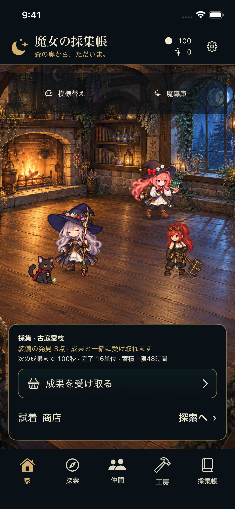

- SHA-256: `e7c58836dd391e1a5dcbed4c3460870ef7a6a52b7a43766e9e1586a98bc1f160`
- 状態revision: `138`
- 実行ファイルSHA-256: `470362cb447ada95e265a15f4d46c8a54fa8304e682f0944e6b702314e233eab`
- [撮影・状態の原記録](../qa_drafts/native_completion_r465/runtime_tools_r001/runs/f3fdf3c8-7ba7-4c69-ae3f-f58253bbadce/RUN.json)

## R465 / 最新通常ビルド。ホーム／検索解除と冷起動。 / empty_search

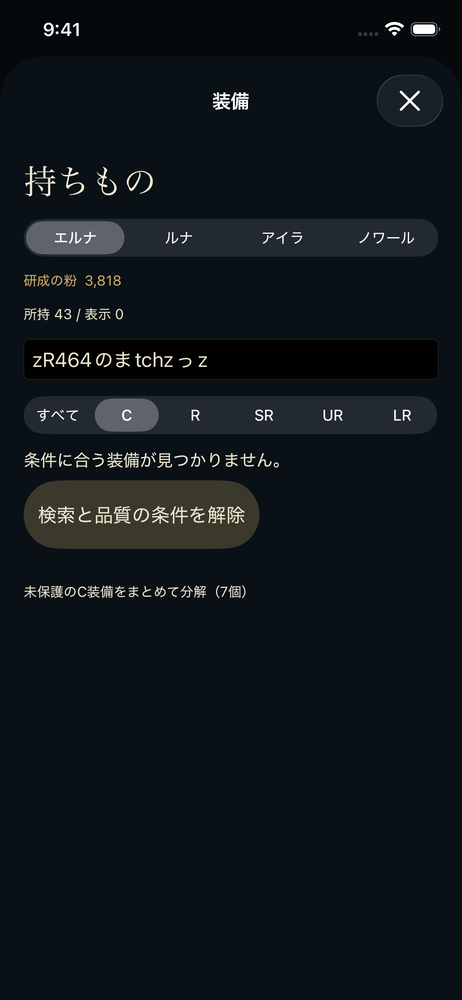

- SHA-256: `18d551c325a2f61f58533093035b3aeebb36d09dc95e529b1d39f8d3bc0ac7c9`
- 状態revision: `138`
- 実行ファイルSHA-256: `470362cb447ada95e265a15f4d46c8a54fa8304e682f0944e6b702314e233eab`
- [撮影・状態の原記録](../qa_drafts/native_completion_r465/runtime_tools_r001/runs/f3fdf3c8-7ba7-4c69-ae3f-f58253bbadce/RUN.json)

## R465 / 最新通常ビルド。ホーム／検索解除と冷起動。 / filters_cleared

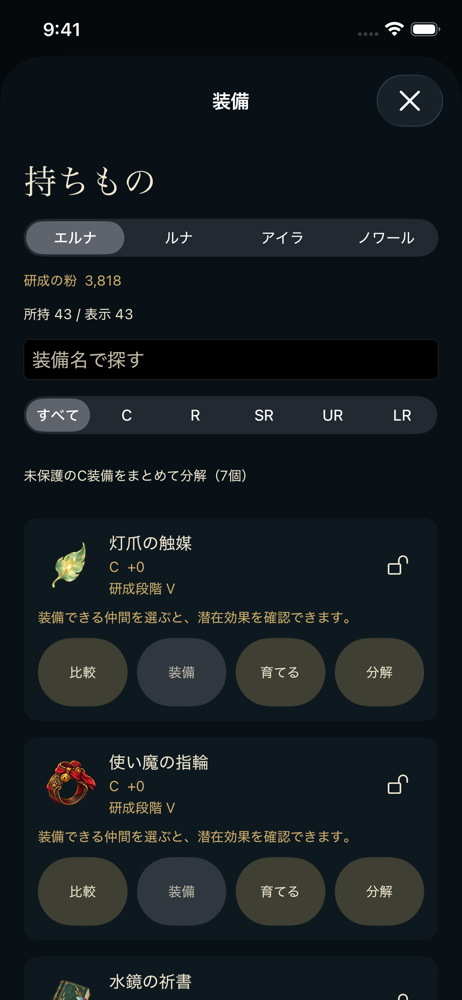

- SHA-256: `e9cea1052b19155614807a3eacbe470724c37d279cf6e1a9ae4c81f619ca552c`
- 状態revision: `138`
- 実行ファイルSHA-256: `470362cb447ada95e265a15f4d46c8a54fa8304e682f0944e6b702314e233eab`
- [撮影・状態の原記録](../qa_drafts/native_completion_r465/runtime_tools_r001/runs/f3fdf3c8-7ba7-4c69-ae3f-f58253bbadce/RUN.json)

## R465 / 最新通常ビルド。ホーム／検索解除と冷起動。 / cold

- SHA-256: `327b7070f9e1dff972b9567a42caa4b60edcef42883b859f97940a6f1ef963de`
- 状態revision: `138`
- 実行ファイルSHA-256: `470362cb447ada95e265a15f4d46c8a54fa8304e682f0944e6b702314e233eab`
- [撮影・状態の原記録](../qa_drafts/native_completion_r465/runtime_tools_r001/runs/f3fdf3c8-7ba7-4c69-ae3f-f58253bbadce/RUN.json)

## R456 / 過去版の補助画面。R05最終ボス戦／装備比較。R465の撮影ではない。 / gear

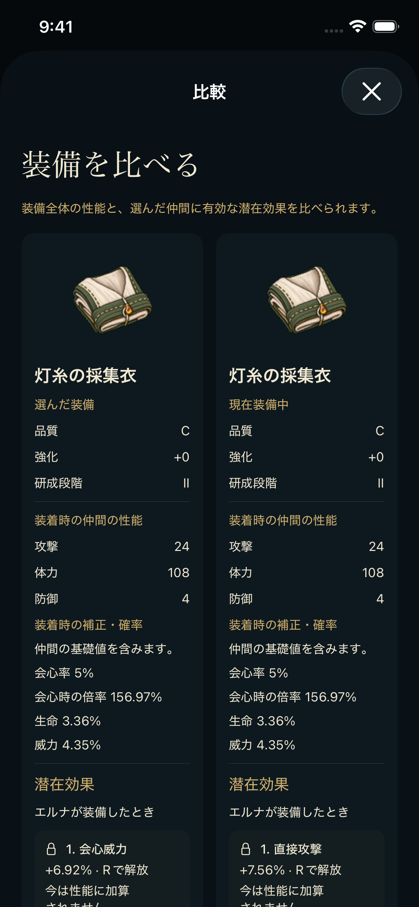

- SHA-256: `f1d6fc6ad24641fd7af3d931da7a05ff5d2cec088a8a3aeba279e44fc4663aeb`
- 状態revision: `137`
- 実行ファイルSHA-256: `2c4e48e8be951691bb2a589656b9524226bfb03386a40ac8f294389fd8cfbcab`
- [撮影・状態の原記録](../qa_drafts/native_completion_r456/runtime_tools_r002/runs/1605ec80-407f-4736-a077-1be866dac17a/RUN.json)

## R456 / 過去版の補助画面。R05最終ボス戦／装備比較。R465の撮影ではない。 / battle

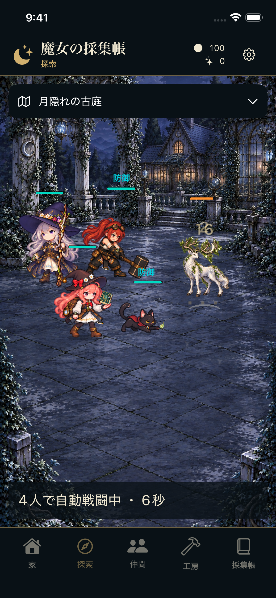

- SHA-256: `2e68e5787e64c7d56ddc29df96521b90664ae35e55f9e536d50ce33a4dc53569`
- 状態revision: `138`
- 実行ファイルSHA-256: `2c4e48e8be951691bb2a589656b9524226bfb03386a40ac8f294389fd8cfbcab`
- [撮影・状態の原記録](../qa_drafts/native_completion_r456/runtime_tools_r002/runs/1605ec80-407f-4736-a077-1be866dac17a/RUN.json)

## R462 / 失敗証拠：解除後もIME文字が残存。R465で修正。

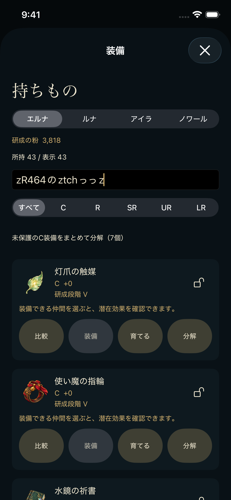

- SHA-256: `c3a00aa8687eb31d264a73e92b43a5aa1ce9b59996cf0b4d7c711afdf29017d3`
- 状態revision: `see source checkpoint`
- 実行ファイルSHA-256: `see R462 root/runtime receipt`
- [撮影・状態の原記録](../qa_drafts/native_completion_r462/runtime_tools_r003/runs/799b47c3-09fb-4461-a16b-2f754a5278be/RUN.json)

## R420 (capture R433) / 過去の通常操作記録 / erna_companion。最新版全画面合格の代用ではない。

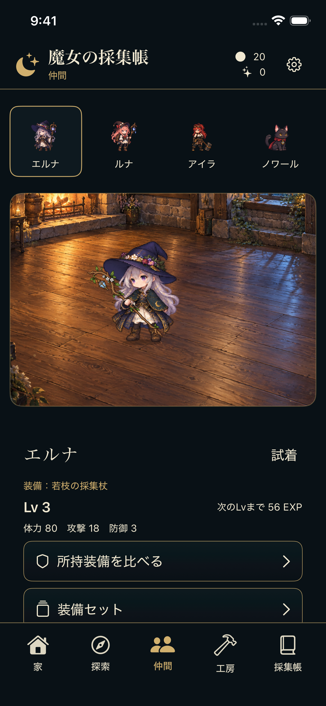

- SHA-256: `dfab6bcc4903b436dfc9978c8d64dc3d7702833db4ea93417ade081fdefb8fd1`
- 状態revision: `23`
- 実行ファイルSHA-256: `ef0c8cb39e6f25b6aec78305e42fdf8df8e16c29ccf2736301253dce4c614f12`
- [撮影・状態の原記録](../qa_drafts/wardrobe_furniture_runtime_r433/execution_r001/checkpoints/erna_companion/CHECKPOINT.json)

## R420 (capture R433) / 過去の通常操作記録 / luna_preview。最新版全画面合格の代用ではない。

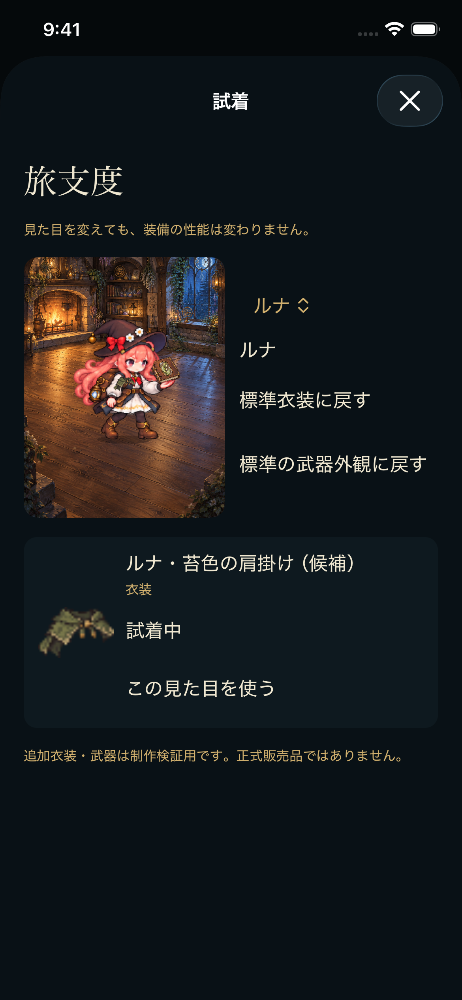

- SHA-256: `b0a57e0b7077819557008e0f4e6fcf3d58a9e39e0a15b1dc5268ac8ea9ec6ca4`
- 状態revision: `17`
- 実行ファイルSHA-256: `ef0c8cb39e6f25b6aec78305e42fdf8df8e16c29ccf2736301253dce4c614f12`
- [撮影・状態の原記録](../qa_drafts/wardrobe_furniture_runtime_r433/execution_r001/checkpoints/luna_preview/CHECKPOINT.json)

## R420 (capture R433) / 過去の通常操作記録 / desk_placed_preview。最新版全画面合格の代用ではない。

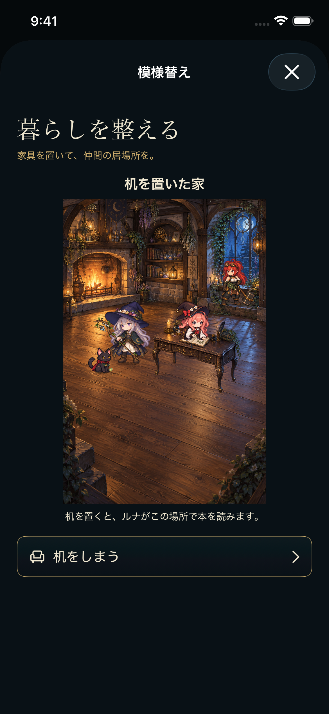

- SHA-256: `d651c46316000a85df27a0ea5b82597eabdebe213ebeb324479778ff7f0752ce`
- 状態revision: `26`
- 実行ファイルSHA-256: `ef0c8cb39e6f25b6aec78305e42fdf8df8e16c29ccf2736301253dce4c614f12`
- [撮影・状態の原記録](../qa_drafts/wardrobe_furniture_runtime_r433/execution_r001/checkpoints/desk_placed_preview/CHECKPOINT.json)

## R420 lineage (capture R443) / 過去の通常操作記録 / all_five_regions_cleared。最新版全画面合格の代用ではない。

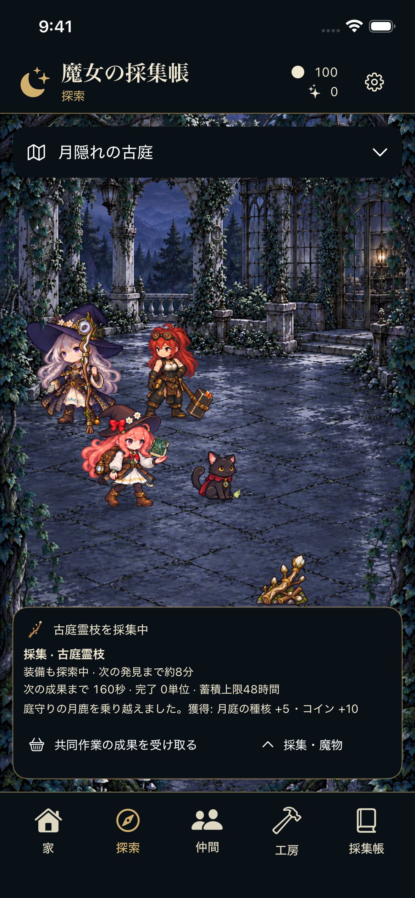

- SHA-256: `21a928cb6d0766103f2e8336cc3a83c5e9394303278cb5ea0dfee1f596e5b60c`
- 状態revision: `91`
- 実行ファイルSHA-256: `ef0c8cb39e6f25b6aec78305e42fdf8df8e16c29ccf2736301253dce4c614f12`
- [撮影・状態の原記録](../qa_drafts/normal_progression_continuation_r443/candidate_r002/execution_r001/checkpoints/all_five_regions_cleared/CHECKPOINT.json)

## R420 lineage (capture R443) / 過去の通常操作記録 / earned_book_evolved。最新版全画面合格の代用ではない。

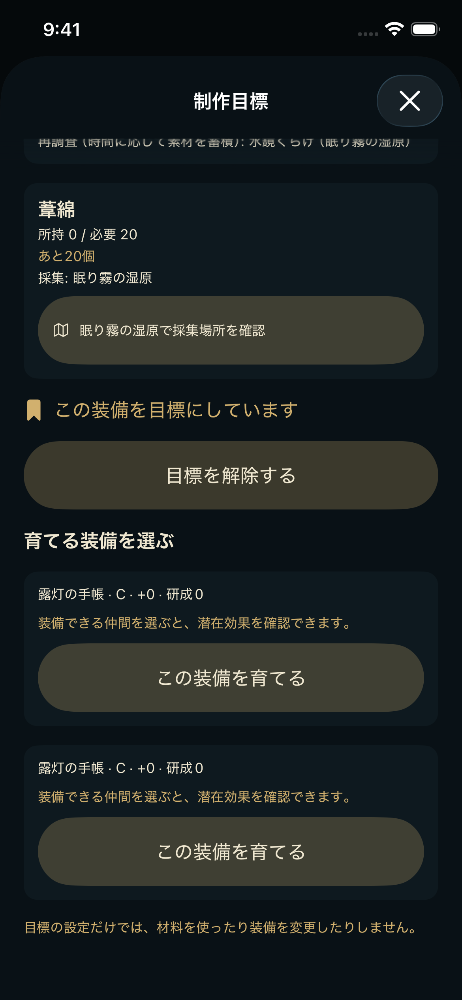

- SHA-256: `6150d5e3ab85d6493f0d16366161d3abc8fa585c9d29255822c845e17c06b55a`
- 状態revision: `88`
- 実行ファイルSHA-256: `ef0c8cb39e6f25b6aec78305e42fdf8df8e16c29ccf2736301253dce4c614f12`
- [撮影・状態の原記録](../qa_drafts/normal_progression_continuation_r443/candidate_r002/execution_r001/checkpoints/earned_book_evolved/CHECKPOINT.json)

## 画像だけで確定できない事項

R443のall_five_regions_cleared画像は月光の庭の探索画面で、全クリア結果一覧ではありません。結果はCLOSUREと保存証拠で確認します。R443のSTARTにはsourceMapSHA256がなく、実行ファイルSHAでの識別までです。R456のbattle画像は戦闘中で、勝利判定は別記録です。R433では当時読書マントの欠陥が残り、その後R444/R446で修正しました。
