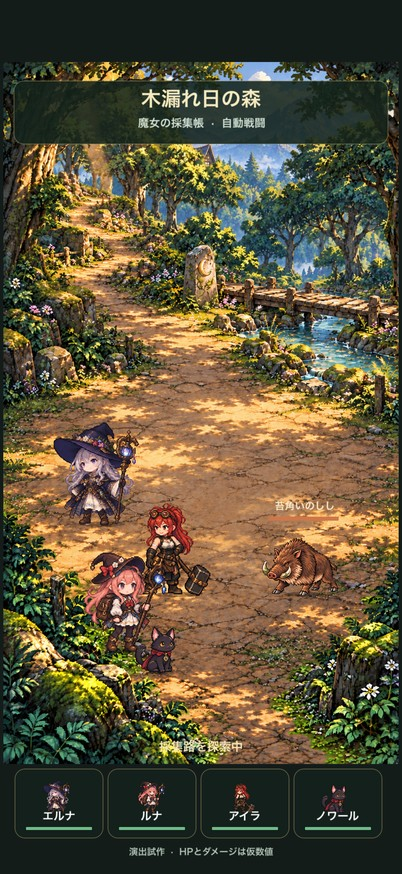
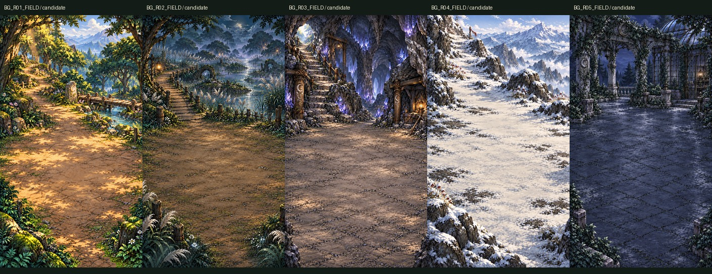

# 『魔女の採集帳』G2 ゲーム画面・継続制作 QA R004

更新日: 2026-10-10 JST。GitHub登録前のローカルレビュー資料。

登録候補: `T-ishikawa00/witch-gathering-log` の `docs/qa/g2_game_integration_20261010_r004/`。このフォルダの内容だけを登録する提案。Git commit・push、外部公開は未実行。

## 動く第1地域

独立したiOS/SpriteKit試作でエルナ・ルナ・アイラ・ノワールと苔角いのししの完全自動戦闘を20秒周期で再生する。予告、通常攻撃、命中、後隙、被弾、退散・勝利を実装。手動スキル・作戦設定なし。HP・ダメージ・攻撃順は演出用仮値で、最終AI・数値・成長仕様ではない。G1コード・セーブに接続しない。

森の4層原画を保持し、前景の描画順を調整した。空合成の画素差0・透明穴0。4人の承認済み設定画を変更せず、候補24ポーズと編集元を制作した。専用滑らかな全尺モーションは未完成。新ポーズの個別採用は未承認。品質未達の他3魔物は戦闘へ採用しない。

[40秒の実際の戦闘動画](previews/FOREST_GAME_R004_PREVIEW_40S.mp4) · [5場面](previews/FOREST_NATIVE_PHASE_CONTACT_R004.jpg) · [4人の候補ポーズ](previews/FOUR_CHARACTER_SIX_POSE_REVIEW_R001.png)

動画はR004のSimulator録画を402×874px・30fpsへ変換した約1.28MBの確認用。R005は復帰診断カウンタだけを変更し、描画設定と261枚の実行PNGはR004と同一。動画のfpsを実行性能として使わない。

## 全159単位の進捗

|項目|件数・意味|
|---|---|
|静的候補|99。Humanは既存画風の方向性を評価、個別採用とは別|
|既存QA合格の保全|84。元ファイル不変|
|個別修正15件|1件が64pt範囲QA合格、14件は全体未解決|
|残る60単位への今回の着手|22。背景5、地点差分2、魔物5、環境効果5、戦闘効果5|
|全159の原画／候補存在|126。部分・失敗・未検証候補も含む|
|原画／候補未制作|33。レビュー不可|
|今回のフルR4キット完成|0。runtime存在や部分QAと別|
|今回の個別正式採用／物理端末検証|各0|

[159行CSV](ledger/UPDATED_159_LEDGER_R003.csv) · [軽量159台帳](ledger/COMPACT_159_LEDGER_R003.json) · [編集元等のSHA参照](ledger/SOURCE_SHA_REFERENCES_R003.json) · [未完成・不足一覧](qa/UNFINISHED_AND_GAPS_R003.md)

`PENDING_INDIVIDUAL` は個別採用記録なしを意味し、159件すべてのレビュー待ちを意味しない。原画なし33件を承認待ちへ数えない。制作済みの部分候補も品質状態を確認して扱う。

全5地域46効果・主368フレームをnativeで全割当、414件の合成方式・opacityを照合。身体anchorと地域統合は未完。くらげは旧RGB・内部alphaを保ち外周ハローを修正しnative60枚と6終端を確認したが、予告と退散は未達。猪は152フレームを再利用して試作表示。他個体の不合格リグを一括展開していない。

## Simulator検証と制約

402×874ptと375×667ptの実画面を確認。Proは24周、SE3は35周の観測時点でイベント重複0、欠落FX0。261 PNGは一度だけ読込。猪の終端失敗0。Proのcycle1以降の中間省略0、SE3では16記録に省略あり。

初回撮影周期を除外した更新callbackはPro59〜60回/秒、SE3 49〜60回/秒。resident memoryはPro196.8〜205.3MiB、SE3 188.8〜195.5MiB。callbackは表示/GPU FPSではなく、複数Simulator環境での参考値。初回撮影等を含む別記録では約221MiB。開発ログの長時間上限は未実装。物理iPhoneのCPU/GPU、発熱・電池、スリープ・killは未検証。runtime profileはUNFROZEN。

Simulatorのバックグラウンド停止・同境界からの復帰と重複0を確認。リンカー自動adhoc署名であり、Developer証明書・Team・provisioning・私有端末は使っていない。

[戦闘集計](qa/FOREST_FINAL_QA_SUMMARY_R005.json) · [復帰QA](qa/FOREST_LIFECYCLE_QA_R005.json) · [保全QA](qa/PROTECTED_FINAL_VERIFICATION_R001.json) · [修正履歴](qa/REPAIR_AND_INTEGRATION_HISTORY_R003.md)

G1・設計正本・承認設定画・旧成果17,494ファイルは変更・欠落0。Git HEAD/index/config不変。外部連絡・投稿・公開、契約・支払、認証設定変更は未実行。

## 含むものと保存先

この軽量資料には要約、159台帳、SHA参照、QA、縮小プレビューと40秒動画を含む。原画・ORA・Blender・リグ・実行アプリ・約90MBの録画原本は含めない。編集可能な制作元と全参照台帳はローカル `assets/g2/production/codex_integration_20261009T133015Z_ddbec58c/` に保管。SHA参照内のrepository相対パスはローカル全成果の場所であり、このGitHub資料に全payloadが入る意味ではない。

この資料だけのcommit・pushにもHumanの別途承認が必要。個別アート採用や実機合格をこの登録で承認済みにしない。

R004ではUI QA内の6つのスクリーンショットSHA参照キーをrepository相対パスへ統一した。該当画像はローカルの全成果に保管し、軽量資料には含めない。これは原画・QA判定の変更ではない。
